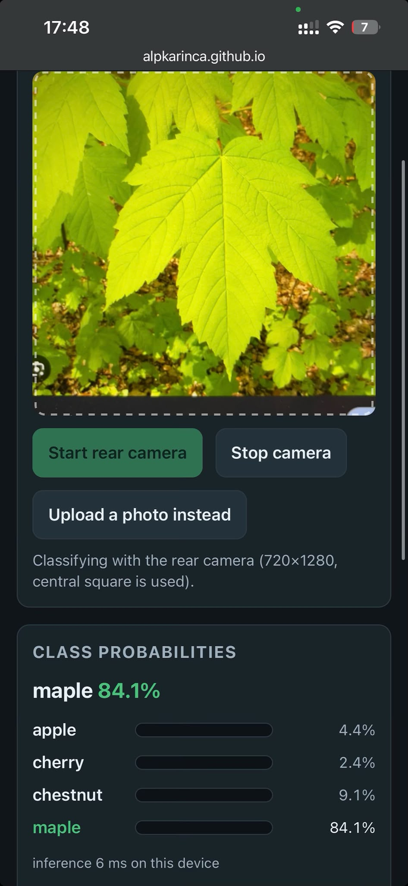

# Review: my leaf classifier page

Page: https://alpkarinca.github.io/mlr-ex08/
Repository: https://github.com/alpkarinca/mlr-ex08

## 1. It runs on my phone
I opened the page on my phone and pointed the camera at a leaf. The screenshot shows the live probabilities:

## 2. The same numbers as the notebook
I uploaded `check_image.jpg` on the page (the page also has a self test with `?selftest=1`).

| Class | Notebook (`check_expected.json`) | Page |
|---|---|---|
| apple | 0.829588 | 0.829591 |
| cherry | 0.167952 | 0.167949 |
| chestnut | 0.002456 | 0.002456 |
| maple | 0.0000037 | 0.0000037 |

They are the same to three decimals (the difference is smaller than 0.00001). I checked this on my computer in Chrome and on the live page.

**What was fixed:** at first the photo upload did not work. The page deleted the image link before it used the image. The agent fixed this and the check passed after that.

## 3. The preprocessing matches my model
In `index.html`, function `tensorFromSource` (about lines 213–238):
- **Central square crop:** line 220–222 (`Math.min(srcW, srcH)`, then the start point in the middle).
- **Resize to 96 x 96:** line 226 (`drawImage(..., 0, 0, size, size)`). The size comes from `model_info.json` (`input_size`).
- **Divide by 255:** line 234 (`px[o + c] / 255`).
- **Standardize with mean and std:** line 234 (`- CONFIG.mean[c]) / CONFIG.std[c]`). The numbers are read from `model_info.json` (line 178–184).
- **Channel order:** R, G, B, one channel after the other (`data[c * n + i]`), so the shape is channels first: `[1, 3, 96, 96]` (line 237).

It matches `model_info.json` and the `transform` of the notebook (`ToTensor` divides by 255 and puts the channels first, `Normalize` uses the same mean and std). One small difference: in the notebook the photos were already cut to 96 x 96 by the teacher, and the page cuts and resizes the camera frame by itself.

## 4. Nothing leaves the phone
- The image is only used inside the browser (canvas and onnxruntime). I searched the code: there is no upload, no `XMLHttpRequest`, no `sendBeacon`. The only `fetch` calls read `model_info.json` and `check_image.jpg` from the same site.
- The page loads these things from the internet:
  - `cdn.jsdelivr.net`: `onnxruntime-web` (the library that runs the model, with its WebAssembly files) and `qrcode-generator` (draws the QR code in the browser). They are loaded from a CDN because the task asks for it.
  - Same site (GitHub Pages): `leaf_model.onnx`, `model_info.json`.
- The QR code is made in the browser. No QR service is used. I scanned it and it gives the page URL.

## Not perfect / open
- I tested the page in Chrome on a computer and with the phone screenshot above. I did not test every phone and browser.
- The invitation for `MLRteacher` is sent. It is pending until the teacher accepts it.
